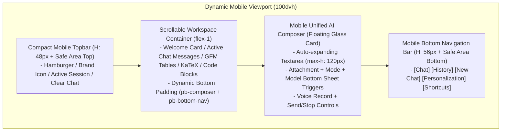

# RADIANCE MOBILE ARCHITECTURE & DESIGN SYSTEM SPECIFICATION

**Document ID:** RADIANCE-ARCH-MOBILE-001  
**Project:** RADIANCE — AI Productivity Platform  
**Target:** Mobile & Tablet Responsive Architecture  
**Author:** Principal Mobile UX Architect & Senior Responsive Design Engineer  
**Date:** November 2026  
**Status:** ARCHITECTED & RATIFIED  

---

## 1. Architectural Philosophy: Purpose-Built for Touch & Small Screens

Radiance on mobile is engineered as a **native-feeling web application**, adhering to:
- **Natural Thumb Zone Ergonomics:** 80% of frequent actions (Composer, Model Selector, Mode Selector, New Chat, History, Settings) are placed within comfortable reach of the user's thumb in the lower half of the screen.
- **Dynamic Viewport Stability (`100dvh`):** Layouts anchor strictly to dynamic viewport dimensions, preventing browser navigation bar shifts (Safari bottom bar, Chrome top address bar) and virtual keyboard popups from displacing the interface.
- **Progressive Disclosure via Bottom Sheets:** Replaces cramped desktop dropdowns with accessible, gesture-dismissible mobile bottom sheets for model selection, mode switching, and attachments.
- **Adaptive Performance:** Gracefully adapts Three.js ambient graphics, blur filters, and particle simulations to match mobile battery and GPU constraints.



---

## 2. Responsive Design Tokens & Semantic Variables

Added to `src/app/globals.css`:

```css
:root {
  /* Mobile Dimensions & Ergonomics */
  --touch-target-min: 44px;
  --touch-target-comfortable: 48px;
  --mobile-topbar-h: 52px;
  --mobile-bottom-nav-h: 58px;
  --mobile-composer-min-h: 54px;
  --mobile-drawer-w: 290px;
  
  /* Safe Area Insets (iOS Safari, Dynamic Island, Android Gestures) */
  --sat: env(safe-area-inset-top, 0px);
  --sar: env(safe-area-inset-right, 0px);
  --sab: env(safe-area-inset-bottom, 0px);
  --sal: env(safe-area-inset-left, 0px);

  /* Fluid Mobile Type Scale */
  --type-hero: clamp(1.75rem, 6vw, 2.75rem);
  --type-subhead: clamp(0.875rem, 3vw, 1.05rem);
  --type-body: 0.9375rem; /* 15px - optimal mobile readability */
  --type-code: 0.8125rem; /* 13px */
  --type-caption: 0.6875rem; /* 11px */
  
  /* Mobile Spacing Grid (4px/8px rhythm) */
  --space-mobile-xs: 4px;
  --space-mobile-sm: 8px;
  --space-mobile-md: 12px;
  --space-mobile-lg: 16px;
  --space-mobile-xl: 24px;
}
```

---

## 3. Navigation Strategy: Bottom Navigation & Coordinated Composer

### 3.1 Mobile Navigation Architecture
On mobile screens (`< 768px`), users interact with the app via two complementary lower-screen elements:
1. **The Floating Unified Composer:** Fixed near the bottom with safe-area spacing.
2. **The Mobile Bottom Navigation Bar:** Placed immediately beneath the composer (or seamlessly integrated) offering:
   - **New Chat** (quick action)
   - **History** (drawer trigger)
   - **Personalization** (theme & tone drawer)
   - **Shortcuts / More** (accessible dialog)

### 3.2 Coordination Between Composer & Navigation
- When the user starts typing in the composer or when the virtual keyboard engages, the bottom navigation bar smoothly yields space or compacts, ensuring 100% of the visible viewport is available for the conversation and typing.
- When idle on the welcome screen or reviewing conversation history, the bottom navigation bar provides instant thumb-reach navigation without reaching to the top corners.

---

## 4. Mobile Bottom Sheets Architecture

Desktop popovers (`bottom-full mb-2`) fail on small screens. Radiance replaces them on mobile (`< 768px`) with **Accessible Mobile Bottom Sheets**:
- **Trigger:** Tapping "Model Selector", "Build Mode", or "Add Files".
- **Presentation:** Slides up from the bottom of the viewport with a subtle dark backdrop (`bg-black/60 backdrop-blur-sm`).
- **Drag Handle:** Visual pill indicator (`w-10 h-1 rounded-full bg-white/20`) at the top of the sheet.
- **Scroll Containment:** The sheet's internal content scrolls smoothly with `-webkit-overflow-scrolling: touch` and `overscroll-behavior: contain`.
- **Dismissal:** Tapping the backdrop, tapping the close button, or pressing Escape dismisses the sheet immediately.
- **Focus Management:** Focus is retained within the sheet while open; restores to trigger on close.

---

## 5. Responsive Breakpoint & Device Matrix

| Viewport Range | Classification | Layout Strategy |
|:---|:---|:---|
| **< 360px** | Ultra-narrow phones (e.g. Galaxy Fold outer, iPhone SE 1st gen) | Ultra-compact topbar, single-column prompt cards, abbreviated button labels, full-width modal sheets. |
| **360px – 430px** | Standard & Large Smartphones (iPhone 13/14/15/16, Pixel 7/8/9, Galaxy S23/S24) | Compact topbar with brand mark, horizontal prompt category pill row, floating composer with bottom-sheet selectors, bottom navigation bar. |
| **431px – 767px** | Large phones in landscape, phablets | Condensed landscape layout: reduced vertical hero padding, side-by-side composer controls. |
| **768px – 1024px** | Tablets portrait & small laptops (iPad, iPad Mini, Surface) | Adaptive tablet layout: collapsible sidebar (68px icon dock), multi-column suggestion cards, standard desktop dropdown popovers. |
| **> 1024px** | Desktop & Ultra-wide Workstations | Full desktop layout with expandable sidebar dock, 3-column suggestion grid, hover action toolbars. |

---

## 6. Three.js Mobile Performance Optimization

To protect battery life and guarantee 60fps on mobile devices:
1. **Adaptive Particle Allocation:**
   - Desktop (`>= 768px`): 2,200 celestial particles.
   - Mobile (`< 768px`): 600 particles (73% reduction in vertex and fragment processing).
2. **DPR Clamping:**
   - Desktop: `min(devicePixelRatio, 2)`.
   - Mobile: `min(devicePixelRatio, 1.5)` (cuts fragment fill rate in half on 3x Retina displays).
3. **Geometry Level-of-Detail (LOD):**
   - 4 icosahedron meshes: detail level reduced from 4 to 2 on mobile (reducing triangle count from 1,280 to 80 triangles per mesh).
4. **Visibility Lifecycle Management:**
   - Listen to `document.addEventListener("visibilitychange")`.
   - Cancel `requestAnimationFrame` when `document.hidden === true`.
   - Resume cleanly when returning to the tab.
5. **Reduced Motion Adaptation:**
   - If `prefers-reduced-motion: reduce` is detected, stop animation loops or render a single static atmospheric frame.
