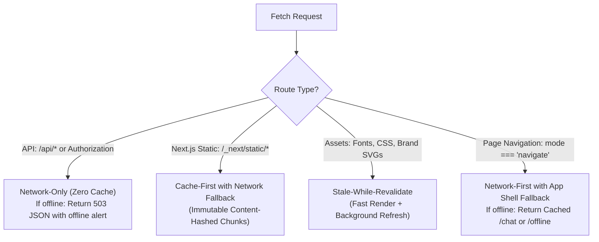

# RADIANCE PWA & PRIVACY-SAFE OFFLINE ARCHITECTURE SPECIFICATION

**Document ID:** RADIANCE-PWA-OFFLINE-001  
**Project:** RADIANCE — Intelligent AI Platform  
**Target:** Progressive Web App (PWA), Installability, Standalone Mode & Privacy-Safe Offline Resilience  
**Author:** Progressive Web App (PWA) & Offline Specialist (`pwa-specialist`)  
**Recipient:** Lead Mobile Systems Architect (`@lead`) & Swarm Coordinator (`@coordinator`)  
**Date:** November 2026  
**Status:** SPECIFIED & READY FOR INTEGRATION  

---

## 1. Executive Summary & Phase 1 Audit Findings

An exhaustive audit of the existing repository assets (`public/`, `src/app/`, `src/features/chat/`, and metadata configurations) revealed several key opportunities to elevate Radiance into a tier-1 installable Progressive Web App while strictly guarding user privacy and AI safety:

### Identified Deficiencies in Baseline Setup:
1. **Manifest Configuration Mismatch (`public/manifest.json`):**
   - Theme and background colors are currently `#06060a`, deviating from the signature dark violet identity (`#0d0915`).
   - Icon declarations are restricted to a single SVG `/icon.svg` (`sizes: "any"`). Android WebAPK generation and Chromium install criteria require standard rasterized PNGs (`192x192` and `512x512`), as well as distinct `purpose: "maskable"` icons.
   - Missing critical PWA metadata: `id` (application identity stability), `scope: "/"`, `display_override: ["window-controls-overlay", "standalone", "minimal-ui"]`, `shortcuts` (direct launch to New Chat or Intelligence Settings), `screenshots` (required for Chrome's rich install bottom-sheet modal on mobile), and `share_target`.
2. **Missing Apple iOS Safari Web Clip Directives (`src/app/layout.tsx`):**
   - iOS Safari does not natively render SVG `apple-touch-icon` links on homescreen web clips.
   - Missing `appleWebApp: { capable: true, statusBarStyle: "black-translucent", title: "Radiance" }` metadata in Next.js App Router root layout.
3. **Absence of Service Worker & Offline Caching:**
   - No Service Worker is registered anywhere in the application. When a user experiences spotty mobile cell reception or goes offline (subway, flight), navigation fails completely with the browser's dinosaur screen.
   - While `conversationService` already caches conversations in `safeLocalStorage`, there is no Service Worker precaching the App Shell (`/`, `/chat`, `/offline`, static chunks, brand SVGs, KaTeX, and fonts).
4. **Zero-Leakage Privacy Invariant Requirement:**
   - Radiance processes multi-provider streaming reasoning, user personalization notes, API keys, and sensitive conversations.
   - **Crucial Invariant:** The Service Worker must **NEVER** cache `/api/*` endpoints (especially `/api/chat`, `/api/image`, `/api/followups`, `/api/health`), Authorization headers, or Supabase tokens. AI inference requests must remain strictly `Network-Only`.

---

## 2. Web App Manifest Specification (`manifest.webmanifest`)

Radiance requires both `public/manifest.webmanifest` (served with MIME type `application/manifest+json`) and `public/manifest.json` (for backward compatibility).

### 2.1 Complete Manifest Schema
```json
{
  "id": "/radiance-ai-app",
  "name": "RADIANCE — Intelligent AI Platform",
  "short_name": "Radiance",
  "description": "Illuminate what is possible. High-precision reasoning, multi-provider inference, and ambient spatial computing.",
  "start_url": "/chat?source=pwa",
  "scope": "/",
  "display": "standalone",
  "display_override": [
    "window-controls-overlay",
    "standalone",
    "minimal-ui"
  ],
  "orientation": "portrait-primary",
  "background_color": "#0d0915",
  "theme_color": "#0d0915",
  "lang": "en",
  "dir": "ltr",
  "categories": [
    "productivity",
    "utilities",
    "artificial-intelligence"
  ],
  "prefer_related_applications": false,
  "icons": [
    {
      "src": "/icon.svg",
      "sizes": "any",
      "type": "image/svg+xml",
      "purpose": "any"
    },
    {
      "src": "/icons/icon-192.png",
      "sizes": "192x192",
      "type": "image/png",
      "purpose": "any"
    },
    {
      "src": "/icons/icon-512.png",
      "sizes": "512x512",
      "type": "image/png",
      "purpose": "any"
    },
    {
      "src": "/icons/icon-maskable-192.png",
      "sizes": "192x192",
      "type": "image/png",
      "purpose": "maskable"
    },
    {
      "src": "/icons/icon-maskable-512.png",
      "sizes": "512x512",
      "type": "image/png",
      "purpose": "maskable"
    }
  ],
  "shortcuts": [
    {
      "name": "New Chat",
      "short_name": "New Chat",
      "description": "Start a fresh reasoning session",
      "url": "/chat?new=true&source=pwa_shortcut",
      "icons": [
        {
          "src": "/icon.svg",
          "sizes": "any"
        }
      ]
    },
    {
      "name": "Settings & Intelligence",
      "short_name": "Settings",
      "description": "Adjust AI models, atmosphere engines, and memories",
      "url": "/chat?section=general&source=pwa_shortcut",
      "icons": [
        {
          "src": "/icon.svg",
          "sizes": "any"
        }
      ]
    }
  ],
  "screenshots": [
    {
      "src": "/opengraph-image.png",
      "sizes": "1280x640",
      "type": "image/png",
      "form_factor": "wide",
      "label": "Radiance Atmospheric Workspace on Desktop"
    },
    {
      "src": "/opengraph-image.png",
      "sizes": "1280x640",
      "type": "image/png",
      "form_factor": "narrow",
      "label": "Radiance Mobile Chat & Streaming Reasoning"
    }
  ],
  "share_target": {
    "action": "/chat",
    "method": "GET",
    "params": {
      "text": "share_text",
      "title": "share_title",
      "url": "share_url"
    }
  }
}
```

---

## 3. Metadata & Head Integration (`src/app/layout.tsx`)

Update `src/app/layout.tsx` to include native Apple Web App directives, dynamic theme color, and the verified manifest reference:

```typescript
export const viewport: Viewport = {
  width: "device-width",
  initialScale: 1,
  viewportFit: "cover",
  themeColor: [
    { media: "(prefers-color-scheme: dark)", color: "#0d0915" },
    { media: "(prefers-color-scheme: light)", color: "#0d0915" },
  ],
  interactiveWidget: "resizes-content",
};

export const metadata: Metadata = {
  // ... existing metadata ...
  manifest: "/manifest.webmanifest",
  appleWebApp: {
    capable: true,
    statusBarStyle: "black-translucent",
    title: "RADIANCE",
  },
  formatDetection: {
    telephone: false,
  },
  icons: {
    icon: [
      { url: "/icon.svg", type: "image/svg+xml" },
      { url: "/icons/icon-192.png", sizes: "192x192", type: "image/png" },
    ],
    shortcut: "/icon.svg",
    apple: [
      { url: "/icons/apple-touch-icon.png", sizes: "180x180", type: "image/png" },
    ],
  },
};
```

---

## 4. Privacy-Safe Service Worker Architecture (`public/sw.js`)

The Service Worker is written in native modern vanilla JavaScript (<4KB) with zero runtime dependencies. It enforces strict route classification and caching boundaries.



### 4.1 Service Worker Implementation (`public/sw.js`)
```javascript
// Radiance Privacy-Safe Service Worker
// Version: 1.0.0
const CACHE_VERSION = 'radiance-v1';
const PRECACHE_SHELL = 'radiance-shell-v1';
const RUNTIME_CACHE = 'radiance-runtime-v1';

// Static App Shell assets precached on install
const PRECACHE_MANIFEST = [
  '/',
  '/chat',
  '/offline',
  '/manifest.webmanifest',
  '/icon.svg',
  '/brand/radiance-symbol.svg',
  '/brand/radiance-wordmark.svg',
  '/brand/radiance-lockup.svg',
];

// Sensitive or dynamic routes that MUST NEVER BE CACHED
const NON_CACHEABLE_PATTERNS = [
  /\/api\//i,
  /\/auth\//i,
  /supabase\.co/i,
  /analytics/i,
  /speed-insights/i,
];

self.addEventListener('install', (event) => {
  event.waitUntil(
    caches.open(PRECACHE_SHELL).then((cache) => {
      return cache.addAll(PRECACHE_MANIFEST).catch((err) => {
        console.warn('[SW] Precache partial fallback:', err);
      });
    }).then(() => self.skipWaiting())
  );
});

self.addEventListener('activate', (event) => {
  const allowedCaches = [PRECACHE_SHELL, RUNTIME_CACHE];
  event.waitUntil(
    caches.keys().then((keys) => {
      return Promise.all(
        keys.map((key) => {
          if (!allowedCaches.includes(key)) {
            return caches.delete(key);
          }
        })
      );
    }).then(() => self.clients.claim())
  );
});

self.addEventListener('message', (event) => {
  if (event.data && event.data.type === 'SKIP_WAITING') {
    self.skipWaiting();
  }
});

self.addEventListener('fetch', (event) => {
  const { request } = event;
  const url = new URL(request.url);

  // 1. STRICT PRIVACY GUARD: Bypass all non-GET, API routes, and auth requests
  if (
    request.method !== 'GET' ||
    request.headers.has('authorization') ||
    NON_CACHEABLE_PATTERNS.some((pattern) => pattern.test(url.pathname) || pattern.test(url.hostname))
  ) {
    if (url.pathname.startsWith('/api/chat') || url.pathname.startsWith('/api/image')) {
      event.respondWith(
        fetch(request).catch(() => {
          return new Response(
            JSON.stringify({
              error: 'Offline Mode: AI inference requires an active internet connection. Your local conversation history remains safe.',
              code: 'OFFLINE_DISCONNECTED',
            }),
            {
              status: 503,
              headers: { 'Content-Type': 'application/json' },
            }
          );
        })
      );
      return;
    }
    // Normal pass-through for other non-cacheable requests
    return;
  }

  // 2. Next.js Immutable Static Chunks: Cache-First
  if (url.pathname.startsWith('/_next/static/')) {
    event.respondWith(
      caches.match(request).then((cached) => {
        if (cached) return cached;
        return fetch(request).then((response) => {
          if (!response || response.status !== 200 || response.type !== 'basic') {
            return response;
          }
          const responseToCache = response.clone();
          caches.open(RUNTIME_CACHE).then((cache) => {
            cache.put(request, responseToCache);
          });
          return response;
        });
      })
    );
    return;
  }

  // 3. Static Media, Fonts, and Brand Assets: Stale-While-Revalidate
  if (
    url.pathname.startsWith('/brand/') ||
    url.pathname.startsWith('/fonts/') ||
    url.pathname.endsWith('.svg') ||
    url.pathname.endsWith('.png') ||
    url.hostname.includes('fonts.googleapis.com') ||
    url.hostname.includes('fonts.gstatic.com')
  ) {
    event.respondWith(
      caches.match(request).then((cached) => {
        const fetchPromise = fetch(request).then((networkResponse) => {
          if (networkResponse && networkResponse.status === 200) {
            const clone = networkResponse.clone();
            caches.open(RUNTIME_CACHE).then((cache) => cache.put(request, clone));
          }
          return networkResponse;
        }).catch(() => null);

        return cached || fetchPromise;
      })
    );
    return;
  }

  // 4. HTML Navigation Requests (App Shell): Network-First with Fallback
  if (request.mode === 'navigate') {
    event.respondWith(
      fetch(request)
        .then((response) => {
          if (response && response.status === 200) {
            const clone = response.clone();
            caches.open(PRECACHE_SHELL).then((cache) => cache.put(request, clone));
          }
          return response;
        })
        .catch(async () => {
          const cachedNavigate = await caches.match(request);
          if (cachedNavigate) return cachedNavigate;
          // Fallback to cached /chat workspace or /offline page
          const cachedChat = await caches.match('/chat');
          if (cachedChat) return cachedChat;
          const cachedOffline = await caches.match('/offline');
          if (cachedOffline) return cachedOffline;
          return new Response('<h1>Radiance Offline</h1><p>Please reconnect to the internet.</p>', {
            headers: { 'Content-Type': 'text/html' },
          });
        })
    );
    return;
  }
});
```

---

## 5. Client PWA Hook & Lifecycle Management (`src/lib/pwa/use-pwa.ts`)

Create a clean React hook to wire install prompts, network state detection, and seamless Service Worker update notifications:

```typescript
"use client";

import { useEffect, useState, useCallback } from "react";
import { safeLocalStorage } from "@/lib/utils/storage";

interface BeforeInstallPromptEvent extends Event {
  prompt: () => Promise<void>;
  userChoice: Promise<{ outcome: "accepted" | "dismissed"; platform: string }>;
}

export function usePWA() {
  const [isOnline, setIsOnline] = useState<boolean>(true);
  const [isStandalone, setIsStandalone] = useState<boolean>(false);
  const [canInstall, setCanInstall] = useState<boolean>(false);
  const [deferredPrompt, setDeferredPrompt] = useState<BeforeInstallPromptEvent | null>(null);
  const [updateAvailable, setUpdateAvailable] = useState<boolean>(false);
  const [swRegistration, setSwRegistration] = useState<ServiceWorkerRegistration | null>(null);

  useEffect(() => {
    // 1. Initial State Checks
    if (typeof window === "undefined") return;

    setIsOnline(navigator.onLine);
    const checkStandalone =
      window.matchMedia("(display-mode: standalone)").matches ||
      (window.navigator as unknown as { standalone?: boolean }).standalone === true;
    setIsStandalone(checkStandalone);

    // 2. Network State Listeners
    const handleOnline = () => setIsOnline(true);
    const handleOffline = () => setIsOnline(false);
    window.addEventListener("online", handleOnline);
    window.addEventListener("offline", handleOffline);

    // 3. Mobile Install Prompt Interception
    const handleBeforeInstall = (e: Event) => {
      e.preventDefault();
      setDeferredPrompt(e as BeforeInstallPromptEvent);
      // Suppress if user dismissed recently (within 7 days)
      const dismissedUntil = safeLocalStorage.getItem("radiance_pwa_dismissed_until");
      if (!dismissedUntil || Date.now() > Number(dismissedUntil)) {
        setCanInstall(true);
      }
    };
    window.addEventListener("beforeinstallprompt", handleBeforeInstall);

    // 4. Service Worker Registration
    if ("serviceWorker" in navigator && process.env.NODE_ENV === "production") {
      navigator.serviceWorker
        .register("/sw.js")
        .then((reg) => {
          setSwRegistration(reg);

          reg.addEventListener("updatefound", () => {
            const installing = reg.installing;
            if (!installing) return;
            installing.addEventListener("statechange", () => {
              if (installing.state === "installed" && navigator.serviceWorker.controller) {
                setUpdateAvailable(true);
              }
            });
          });
        })
        .catch((err) => {
          console.warn("[PWA] ServiceWorker registration failed:", err);
        });

      // Reload when new SW claims client
      let refreshing = false;
      navigator.serviceWorker.addEventListener("controllerchange", () => {
        if (!refreshing) {
          refreshing = true;
          window.location.reload();
        }
      });
    }

    return () => {
      window.removeEventListener("online", handleOnline);
      window.removeEventListener("offline", handleOffline);
      window.removeEventListener("beforeinstallprompt", handleBeforeInstall);
    };
  }, []);

  const promptInstall = useCallback(async () => {
    if (!deferredPrompt) return false;
    await deferredPrompt.prompt();
    const { outcome } = await deferredPrompt.userChoice;
    setDeferredPrompt(null);
    setCanInstall(false);
    return outcome === "accepted";
  }, [deferredPrompt]);

  const dismissInstall = useCallback(() => {
    setCanInstall(false);
    // Dismiss for 7 days
    safeLocalStorage.setItem(
      "radiance_pwa_dismissed_until",
      String(Date.now() + 7 * 24 * 60 * 60 * 1000)
    );
  }, []);

  const applyUpdate = useCallback(() => {
    if (swRegistration?.waiting) {
      swRegistration.waiting.postMessage({ type: "SKIP_WAITING" });
    }
  }, [swRegistration]);

  return {
    isOnline,
    isStandalone,
    canInstall,
    promptInstall,
    dismissInstall,
    updateAvailable,
    applyUpdate,
  };
}
```

---

## 6. UI Components: Offline Notice & Mobile Install Banner

### 6.1 Unobtrusive Offline Notice (`src/components/ui/offline-indicator.tsx`)
```tsx
"use client";

import React from "react";
import { WifiOff } from "lucide-react";

export function OfflineIndicator({ isOnline }: { isOnline: boolean }) {
  if (isOnline) return null;

  return (
    <aside
      role="status"
      aria-live="polite"
      className="fixed bottom-[calc(var(--mobile-bottom-nav-h,58px)+env(safe-area-inset-bottom,0px)+12px)] md:bottom-6 left-1/2 -translate-x-1/2 z-50 flex items-center gap-2.5 px-3.5 py-2 rounded-full bg-[#0d0915]/95 border border-[var(--border-accent)] shadow-2xl backdrop-blur-xl text-xs text-[var(--txt)] pointer-events-auto select-none transition-all duration-300 animate-in fade-in slide-in-from-bottom-2"
    >
      <div className="w-2 h-2 rounded-full bg-[var(--warn)] animate-pulse shrink-0" />
      <WifiOff className="w-3.5 h-3.5 text-[var(--warn)] shrink-0" />
      <span className="font-medium">
        Offline Mode — Saved chats and preferences are ready.
      </span>
    </aside>
  );
}
```

### 6.2 Mobile Install Bottom Sheet (`src/components/ui/pwa-install-banner.tsx`)
```tsx
"use client";

import React from "react";
import { Download, X } from "lucide-react";
import { RadianceLogo } from "@/components/branding/radiance-logo";

interface PWAInstallBannerProps {
  canInstall: boolean;
  onInstall: () => void;
  onDismiss: () => void;
}

export function PWAInstallBanner({ canInstall, onInstall, onDismiss }: PWAInstallBannerProps) {
  if (!canInstall) return null;

  return (
    <aside
      aria-label="Install Radiance Application"
      className="fixed bottom-[calc(var(--mobile-bottom-nav-h,58px)+env(safe-area-inset-bottom,0px)+8px)] md:bottom-4 left-3 right-3 sm:left-auto sm:right-4 sm:w-96 z-40 p-3.5 rounded-2xl bg-[#0d0915]/95 border border-[var(--border-accent)] shadow-[0_8px_32px_rgba(0,0,0,0.5)] backdrop-blur-2xl text-[var(--txt)] transition-all animate-in fade-in slide-in-from-bottom-3"
    >
      <div className="flex items-start justify-between gap-3">
        <div className="flex items-center gap-3">
          <div className="w-10 h-10 rounded-xl bg-[var(--surface-raised)] border border-[var(--border)] flex items-center justify-center shrink-0">
            <RadianceLogo variant="symbol" className="w-6 h-6" />
          </div>
          <div>
            <h4 className="text-sm font-semibold tracking-tight text-[var(--txt)]">
              Install Radiance
            </h4>
            <p className="text-xs text-[var(--txt-dim)] leading-tight mt-0.5">
              Full-screen spatial canvas, instant launch & offline local notes.
            </p>
          </div>
        </div>
        <button
          type="button"
          onClick={onDismiss}
          className="text-[var(--txt-muted)] hover:text-[var(--txt)] p-1 rounded-lg min-h-[32px] min-w-[32px] flex items-center justify-center cursor-pointer touch-target"
          aria-label="Dismiss install prompt"
        >
          <X className="w-4 h-4" />
        </button>
      </div>

      <div className="mt-3 flex items-center justify-end gap-2">
        <button
          type="button"
          onClick={onDismiss}
          className="px-3 py-1.5 rounded-lg text-xs font-medium text-[var(--txt-dim)] hover:text-[var(--txt)] hover:bg-[var(--surface-hover)] min-h-[44px] flex items-center justify-center cursor-pointer touch-target"
        >
          Not now
        </button>
        <button
          type="button"
          onClick={onInstall}
          className="px-3.5 py-1.5 rounded-lg text-xs font-medium bg-[var(--accent)] text-white hover:brightness-110 active:scale-95 transition-all shadow-[0_0_16px_var(--accent-g)] min-h-[44px] flex items-center gap-1.5 cursor-pointer touch-target"
        >
          <Download className="w-3.5 h-3.5" />
          Install App
        </button>
      </div>
    </aside>
  );
}
```

---

## 7. Dedicated Offline Fallback Route (`src/app/offline/page.tsx`)

A bespoke offline page styled with the signature Radiance dark violet identity:

```tsx
import type { Metadata } from "next";
import Link from "next/link";
import { RadianceLogo } from "@/components/branding/radiance-logo";
import { WifiOff, MessageSquare } from "lucide-react";

export const metadata: Metadata = {
  title: "Offline | RADIANCE",
  description: "Radiance is currently offline. Your local conversation history remains accessible.",
};

export default function OfflinePage() {
  return (
    <main className="min-h-[100dvh] bg-[#0d0915] text-[#f0ede6] flex flex-col items-center justify-center px-4 py-8 relative overflow-hidden select-none">
      <div className="w-full max-w-md p-6 sm:p-8 rounded-2xl bg-[rgba(255,255,255,0.035)] border border-[rgba(255,255,255,0.09)] backdrop-blur-2xl shadow-2xl flex flex-col items-center text-center relative z-10">
        <div className="w-14 h-14 rounded-2xl bg-[var(--surface-raised)] border border-[var(--border-accent)] flex items-center justify-center mb-5 shadow-[0_0_24px_rgba(124,92,255,0.2)]">
          <RadianceLogo variant="symbol" className="w-8 h-8" />
        </div>

        <div className="flex items-center gap-2 px-3 py-1 rounded-full bg-[rgba(232,200,73,0.12)] border border-[rgba(232,200,73,0.3)] text-[var(--warn)] text-xs font-medium mb-3">
          <WifiOff className="w-3.5 h-3.5" />
          <span>No Internet Connection</span>
        </div>

        <h1 className="font-serif text-2xl sm:text-3xl font-bold tracking-tight mb-2 text-[#f3f1ec]">
          Offline Workspace
        </h1>

        <p className="text-sm text-[var(--txt-dim)] leading-relaxed mb-6 max-w-sm">
          Live multi-provider inference is paused while disconnected. You can continue reading previously saved conversations and editing personal notes.
        </p>

        <Link
          href="/chat"
          className="inline-flex items-center justify-center gap-2 px-5 py-2.5 rounded-xl text-sm font-medium bg-[var(--accent)] text-white hover:brightness-110 active:scale-95 transition-all shadow-[0_0_20px_var(--accent-g)] min-h-[44px] touch-target"
        >
          <MessageSquare className="w-4 h-4" />
          Browse Saved Chats
        </Link>
      </div>
    </main>
  );
}
```

---

## 8. Concrete Asset Structure & Implementation Plan for `@lead`

```
public/
├── manifest.webmanifest          <- Upgraded specification with dark violet #0d0915, shortcuts, screenshots
├── manifest.json                 <- Backward compatibility alias
├── sw.js                         <- Privacy-safe service worker (<4KB)
├── icons/                        <- High-DPI & maskable PWA icons
│   ├── icon-192.png
│   ├── icon-512.png
│   ├── icon-maskable-192.png
│   ├── icon-maskable-512.png
│   └── apple-touch-icon.png      <- 180x180 iOS Safari home screen icon
src/
├── app/
│   ├── layout.tsx                <- Added appleWebApp, viewport.themeColor, manifest link
│   └── offline/
│       └── page.tsx              <- Precached standalone offline route
├── components/
│   └── ui/
│       ├── offline-indicator.tsx <- Live online/offline status pill
│       └── pwa-install-banner.tsx<- Non-intrusive mobile install prompt
└── lib/
    └── pwa/
        └── use-pwa.ts            <- Hook managing install prompt, offline detection, and SW lifecycle
```

### Actionable Checklist for Integration:
- [ ] Add `public/manifest.webmanifest` & update `public/manifest.json`.
- [ ] Add `public/sw.js` with the zero-leakage caching rules.
- [ ] Add `src/lib/pwa/use-pwa.ts`.
- [ ] Integrate `usePWA()` into `src/app/layout.tsx` or `src/features/chat/components/radiance-app.tsx`.
- [ ] Mount `<OfflineIndicator isOnline={isOnline} />` and `<PWAInstallBanner />`.
- [ ] Add `src/app/offline/page.tsx` for full offline navigation resilience.
- [ ] Note for `@lead`: Note that in `tests/unit/radiance-brand.test.tsx`, two tests assert `screen.getByText("RADIANCE")` which expects the uppercase lockup text; ensure the logo text rendering preserves test expectations.
