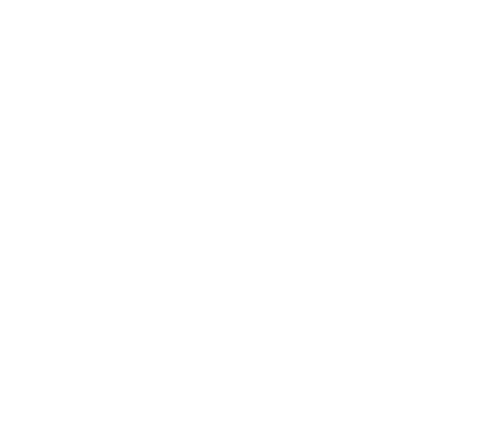
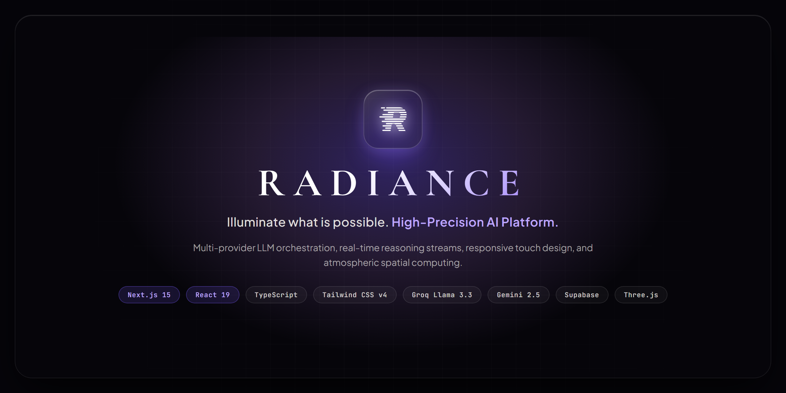
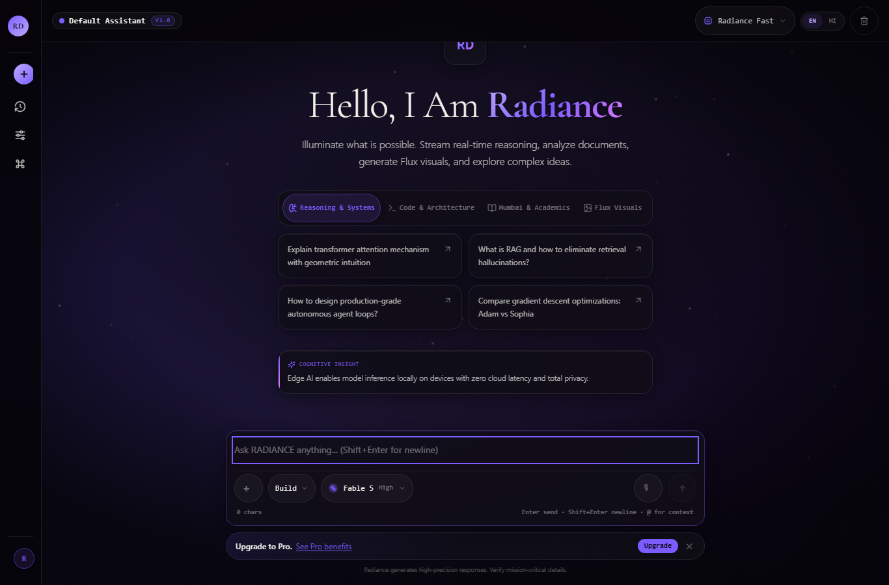
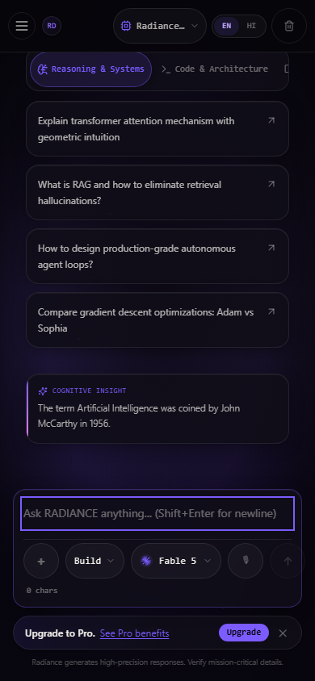
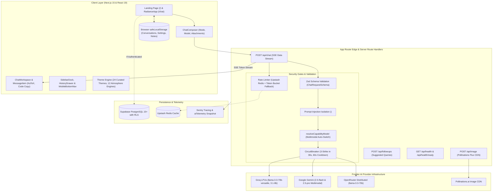

<div align="center">

  

  # RADIANCE

  **Illuminate what is possible.**

  An editorial, high-performance AI workspace and intelligence canvas engineered for multi-model reasoning, spatial design, and user-controlled intelligence.

  <br />

  [](https://github.com/TanishBane/Radiance/actions/workflows/ci.yml)
  [](https://github.com/TanishBane/Radiance/actions/workflows/codeql.yml)
  [](https://github.com/TanishBane/Radiance/actions/workflows/docs.yml)
  [](LICENSE)
  [](https://nextjs.org/)
  [](https://react.dev/)
  [](https://www.typescriptlang.org/)
  [](https://tailwindcss.com/)

  <br />
  <br />

  

</div>

---

## Table of Contents

- [Overview & Philosophy](#overview--philosophy)
- [Key Capabilities](#key-capabilities)
- [Interface Preview](#interface-preview)
- [System Architecture](#system-architecture)
- [Technology Stack](#technology-stack)
- [AI Model Registry](#ai-model-registry)
- [Project Structure](#project-structure)
- [Getting Started](#getting-started)
  - [Prerequisites](#prerequisites)
  - [Installation & Setup](#installation--setup)
  - [Environment Configuration](#environment-configuration)
  - [Running the Application](#running-the-application)
- [Quality Verification & Testing](#quality-verification--testing)
- [Security & Privacy Architecture](#security--privacy-architecture)
- [Documentation Hub](#documentation-hub)
- [Roadmap](#roadmap)
- [Contributing & Community](#contributing--community)
- [License](#license)

---

## Overview & Philosophy

Modern AI interfaces frequently suffer from two opposing extremes: generic, sterile SaaS clones that discard context between turns, or opaque black-box platforms that silently scrape and vectorize user conversations without clear user agency.

**Radiance** takes a fundamentally different approach grounded in three principles:

1. **User Agency Over Black Boxes:** Radiance features **Personal Intelligence** — an explicit note and preference system where users decide what is saved, inspect and edit retained notes, and choose whether retrieved context is attached to outgoing requests. Radiance does not automatically infer memories from chat history.
2. **Capability-Driven Multi-Model Inference:** Rather than locking users to a single vendor, Radiance routes prompts dynamically across **Groq LPUs** for ultra-low latency inference, **Google Gemini** for native vision and document comprehension, and **OpenRouter** for distributed open-weights models. When documents or images are attached, queries automatically route to multimodal-capable models.
3. **Atmospheric Spatial Computing:** Built on an editorial aesthetic with a dark violet canvas (`#06050a`), Cormorant Garamond display headings, Plus Jakarta Sans interface typography, JetBrains Mono code badges, and vibrant multicolour accents (blue, cyan, violet, indigo, coral, rose, emerald, teal, amber) complemented by 12 procedural atmosphere background engines.

---

## Key Capabilities

- **Explicit Personal Intelligence:** Save, edit, export, or delete personal notes (up to 500 characters each). Context retrieval uses bounded lexical scoring (query coverage $0.65$, memory coverage $0.20$, recency $0.10$, importance $0.05$) to inject relevant notes only when opt-in provider sharing is active.
- **Defensive Secret Filtering:** Personal notes are proactively scanned before storage with regex pattern guards and the **Luhn algorithm**, automatically blocking private keys, live API tokens, passwords, SSNs, and credit card numbers from client storage.
- **Resilient SSE Streaming with Token Retention:** Powered by the Vercel AI SDK (`ai` v4.1.54). Canceling inference via the Stop button halts the server stream immediately via `req.signal` while retaining all streamed tokens as a completed conversational turn.
- **Flexible Response Modes:** Choose between **Ask** (concise, direct reasoning), **Plan** (phased roadmaps, dependencies, trade-offs), and **Build** (executable, complete code implementations).
- **Single Regeneration Policy:** Enforces a clean single-regeneration policy per assistant turn (`canRegenerateResponse`), displaying transparent status indicators in the message header.
- **Touch-First Mobile Ergonomics:** Engineered with $100\text{dvh}$ dynamic viewport compensation (`interactiveWidget: "resizes-content"`), thumb-zone bottom navigation (`MobileBottomNav`) that automatically hides when the composer is focused, and minimum $44 \times 44\text{px}$ touch targets.
- **Editorial Typography & KaTeX Math:** Complete GitHub Flavored Markdown (GFM) support, KaTeX LaTeX typesetting for mathematical expressions (`$math$` and `$$math$$`), and streaming-tolerant syntax-highlighted code fences with one-click clipboard copying.
- **In-Browser Document Ingestion:** Client-side `.docx` raw text extraction via Mammoth, magic-byte file signature validation (`%PDF`, `PK..`, `\x89PNG`, `\xFF\xD8\xFF`), and ephemeral preview generation.
- **Atmospheric Background Engines:** 12 interactive background engines, including WebGL Three.js Cosmic 3D, Aurora Curtains, Celestial Meteors, Molten Metablobs, Digital Glyphs, and Radiant Grid, complete with live chat canvas previews.
- **Offline-First Resilience:** Conversations write synchronously to browser storage (`safeLocalStorage`) and dual-write to Supabase PostgreSQL 15+ when authenticated, ensuring zero data loss during network disruptions.

---

## Interface Preview

<div align="center">
  <table>
    <tr>
      <td width="65%" align="center" valign="top">
        <strong>Desktop AI Canvas</strong><br /><br />
        
      </td>
      <td width="35%" align="center" valign="top">
        <strong>Mobile Touch Experience</strong><br /><br />
        
      </td>
    </tr>
  </table>
</div>

---

## System Architecture

Radiance enforces clean boundaries separating presentation components, state orchestration, route handlers, defense gates, and external inference engines:



---

## Technology Stack

| Domain | Technology / Package | Exact Version | Primary Purpose |
|:---|:---|:---|:---|
| **Framework** | [Next.js](https://nextjs.org/) | `15.2.1` | App Router, Server Actions, Node.js route handlers, metadata API |
| **UI Library** | [React](https://react.dev/) | `19.0.0` | React 19 concurrent features, Server & Client Components, Hooks |
| **Language** | [TypeScript](https://www.typescriptlang.org/) | `5.8.2` | Strict static typing across all application components and APIs |
| **Styling** | [Tailwind CSS](https://tailwindcss.com/) | `4.0.12` | Modern CSS-first `@theme` configuration, zero-runtime CSS tokens |
| **Primitives** | [Radix UI](https://www.radix-ui.com/) | `1.1.x / 2.1.x` | Accessible dialogs, popovers, dropdown menus, and tooltips |
| **Motion** | [Motion for React](https://motion.dev/) | `12.4.10` | Hardware-accelerated UI transitions with full reduced-motion support |
| **3D & Shaders** | [Three.js](https://threejs.org/) / R3F | `0.174.0` / `9.8.2` | WebGL Starfield, cosmic shaders, post-processing effects |
| **AI SDK** | [Vercel AI SDK](https://sdk.vercel.ai/) | `4.1.54` | `streamText`, `CoreMessage` protocol, Server-Sent Events stream |
| **AI Providers** | Groq, Gemini, OpenAI | `1.1.x` | `@ai-sdk/groq`, `@ai-sdk/google`, `@ai-sdk/openai` wrappers |
| **Database & Auth**| [Supabase](https://supabase.com/) | `2.49.1` / `0.5.2` | PostgreSQL 15+, Row-Level Security, `@supabase/ssr` cookies |
| **Rate Limiting** | [Upstash Redis](https://upstash.com/) | `1.40.0` / `2.2.0` | Distributed sliding window with bounded local token-bucket fallback |
| **Validation** | [Zod](https://zod.dev/) | `3.24.2` | Request body, settings, and memory profile schema verification |
| **Observability** | [Sentry](https://sentry.io/) | `11.11.0` | Client/server error monitoring, tracing, `/monitoring` tunnel |
| **Math & Typography**| [KaTeX](https://katex.org/) | `0.19.1` | Inline and display LaTeX mathematical typesetting |
| **Document Parser**| [Mammoth](https://github.com/mwilliamson/mammoth.js) | `1.13.0` | Client-side `.docx` raw text extraction |
| **Testing** | [Vitest](https://vitest.dev/) / [Playwright](https://playwright.dev/) | `3.0.8` / `1.64.1` | 66 Vitest unit/adversarial suites, cross-browser Playwright matrix |

---

## AI Model Registry

Radiance maintains an active registry of frontier inference models in [src/lib/ai/models.ts](src/lib/ai/models.ts):

| Model ID | Display Name | Provider | Upstream Model | Vision | PDF | Context Window | Max Output | Tier |
|:---|:---|:---|:---|:---:|:---:|:---|:---|:---|
| `groq-fast` *(Default)* | Radiance Fast | Groq | `llama-3.3-70b-versatile` | No | No | 131,072 | 4,096 | Standard |
| `groq-instant` | Radiance Instant | Groq | `llama-3.1-8b-instant` | No | No | 131,072 | 4,096 | Free |
| `gemini-quality` | Radiance Multimodal | Google | `gemini-2.5-flash` | **Yes** | **Yes** | 1,048,576 | 4,096 | Standard |
| `gemini-pro` | Radiance Pro Reasoning | Google | `gemini-2.5-pro` | **Yes** | **Yes** | 1,048,576 | 4,096 | Paid |
| `openrouter-reasoning` | Radiance OpenWeights | OpenRouter | `meta-llama/llama-3.3-70b-instruct` | No | No | 131,072 | 4,096 | Standard |

---

## Project Structure

```
Radiance/
├── .github/workflows/         # CI/CD, CodeQL, Dependency Review, Gitleaks, Docs validation
├── docs/                      # Comprehensive technical architecture, feature, and operational guides
│   ├── architecture/          # Topology and AI streaming pipeline
│   ├── assets/                # Screenshots, brand marks, and social cards
│   ├── development/           # Local development and testing guidelines
│   ├── features/              # Conversation lifecycle and model registry
│   ├── getting-started/       # Onboarding and environment configuration
│   └── operations/            # Sentry, incident response, troubleshooting
├── public/                    # Brand assets, favicons, web app manifest
├── scripts/                   # Bundle measurement, link auditing, social card generators
├── src/
│   ├── app/                   # Next.js App Router (layout, page, chat, privacy, not-found, APIs)
│   ├── components/            # UI components (chat, navigation, background, branding, landing)
│   ├── features/              # Feature domains (chat hooks, intelligence store, settings center)
│   └── lib/                   # AI providers, Supabase, types, observability, security, utils
├── supabase/migrations/       # PostgreSQL 15+ schema with Row-Level Security (RLS) policies
└── tests/
    ├── e2e/                   # Playwright cross-browser specifications
    └── unit/                  # Vitest unit and adversarial stress test suites
```

---

## Getting Started

### Prerequisites

- **Node.js:** `v20.x` or `v22.x` (LTS recommended)
- **pnpm:** `v9.x` or `v10.x` (`npm install -g pnpm`)
- **Git:** `v2.30+`

### Installation & Setup

1. **Clone the repository:**
   ```bash
   git clone https://github.com/TanishBane/Radiance.git
   cd Radiance
   ```

2. **Install dependencies using frozen lockfile:**
   ```bash
   pnpm install --frozen-lockfile
   ```

### Environment Configuration

Copy the environment template to create your local `.env.local`:

```bash
cp .env.example .env.local
```

Configure your AI provider credentials. At least one inference API key is required to stream responses:

```bash
# ── AI MODEL PROVIDER CREDENTIALS (SERVER-SIDE ONLY) ──
GROQ_API_KEY="gsk_your_groq_api_key_here"
GEMINI_API_KEY="AIzaSy_your_gemini_api_key_here"
OPENROUTER_API_KEY="sk-or-v1-your_openrouter_api_key_here"

# ── SUPABASE PERSISTENCE & AUTH (OPTIONAL - LOCAL STORAGE FALLBACK ACTIVE) ──
NEXT_PUBLIC_SUPABASE_URL="https://your-project.supabase.co"
NEXT_PUBLIC_SUPABASE_ANON_KEY="your-supabase-anon-key"

# ── RATE LIMITING (OPTIONAL - IN-MEMORY FALLBACK ACTIVE) ──
UPSTASH_REDIS_REST_URL=""
UPSTASH_REDIS_REST_TOKEN=""
```

Refer to the [Environment Setup Guide](docs/getting-started/environment.md) for full parameter definitions.

### Running the Application

```bash
pnpm dev
```

Navigate to [http://localhost:3000](http://localhost:3000) for the landing page or [http://localhost:3000/chat](http://localhost:3000/chat) to enter the chat workspace.

---

## Quality Verification & Testing

Radiance enforces an **evidence-before-claims** discipline (`verification-before-completion`). Run the official quality commands:

```bash
# 1. Strict TypeScript compilation check
pnpm typecheck

# 2. ESLint static code analysis
pnpm lint

# 3. Vitest unit & adversarial stress test suites
pnpm test

# 4. Cross-browser Playwright End-to-End matrix
pnpm test:e2e

# 5. Production Next.js build compilation
pnpm build

# 6. Production bundle size budget audit (< 800kB /page, < 220kB /layout)
pnpm measure:bundle

# 7. Documentation link and asset integrity audit
pnpm docs:check
```

---

## Security & Privacy Architecture

Radiance implements multi-layer defense-in-depth protections:

- **Strict Content Security Policy (CSP):** Enforced in [next.config.ts](next.config.ts) with `frame-ancestors 'none'` and restrictive outbound connect origins.
- **Edge Header Spoof Defense:** `getTrustedClientIp` prioritizes platform-authenticated Cloudflare and Vercel edge headers to prevent rate-limit evasion via spoofed `X-Forwarded-For`.
- **Memory-Bounded Rate Limiting:** Local token-bucket fallback bounds active client buckets to 10,000 with periodic FIFO eviction, preventing memory exhaustion attacks.
- **Circuit Breaker Poisoning Prevention:** Requires 3 consecutive failures within 30 seconds before tripping provider circuits, preventing single-tenant DoS poisoning.
- **Prompt Injection Isolation:** Personal notes are wrapped inside `<RADIANCE_PERSONAL_CONTEXT_UNTRUSTED>` with HTML-safe JSON escaping, with system prompts explicitly instructed to treat them as untrusted reference material.
- **Secret Filtering with Luhn Validation:** Personal intelligence automatically blocks private keys, API tokens, passwords, SSNs, and credit cards from storage.
- **Row-Level Security (RLS):** All Supabase database tables enforce `auth.uid() = user_id` across `SELECT`, `INSERT`, `UPDATE`, and `DELETE`.

Review our [Security Policy](SECURITY.md) for vulnerability disclosure guidelines.

---

## Documentation Hub

Explore the in-depth documentation tree:

- **Getting Started:**
  - [Installation Guide](docs/getting-started/installation.md)
  - [Environment Variables](docs/getting-started/environment.md)
- **Architecture:**
  - [System Overview & Layer Boundaries](docs/architecture/overview.md)
  - [AI Orchestration & Streaming Pipeline](docs/architecture/ai-orchestration.md)
- **Features:**
  - [Conversation Engine & Chat Lifecycle](docs/features/conversations.md)
  - [Multi-Model Registry & Capability Matrix](docs/features/model-selection.md)
- **Development:**
  - [Local Development Guide](docs/development/local-development.md)
  - [Testing & Verification Strategy](docs/development/testing.md)
- **Operations & Runbooks:**
  - [Operational Overview](docs/operations/OVERVIEW.md)
  - [Sentry Monitoring](docs/operations/SENTRY.md)
  - [CI/CD Automation](docs/operations/CI_CD.md)
  - [Incident Response](docs/operations/INCIDENT_RESPONSE.md)
  - [Troubleshooting Runbook](docs/operations/TROUBLESHOOTING.md)

---

## Roadmap

- [x] **v1.0.0 — Production Core**
  - Next.js 15 App Router + React 19 architecture
  - Multi-provider inference (Groq LPUs, Google Gemini, OpenRouter)
  - Capability-based automatic multimodal switching for vision and PDFs
  - Touch-first mobile ergonomics with $100\text{dvh}$ composer compensation
  - KaTeX LaTeX mathematical typesetting & syntax-highlighted code fences
  - User-controlled Personal Intelligence with secret filtering (Luhn)
  - Health probe endpoints (`/api/health`, `/api/health/ready`)
  - Enterprise Sentry observability & Upstash Redis rate limiting
- [ ] **v1.1.0 — Retrieval-Augmented Generation (Planned)**
  - Optional pgvector semantic similarity search over stored documents
  - Client-side Web Crypto (AES-GCM) encrypted vaults for sensitive notes
  - Multi-user collaborative workspaces with role-based access controls

---

## Contributing & Community

We welcome contributions from the community! Please review our community standards before opening an issue or pull request:

- [Contributing Guidelines](CONTRIBUTING.md)
- [Contributor License Agreement](CONTRIBUTOR_LICENSE_AGREEMENT.md)
- [Code of Conduct](CODE_OF_CONDUCT.md)
- [Security Policy](SECURITY.md)
- [Changelog](CHANGELOG.md)

---

## License & Intellectual Property

Radiance is source-available software licensed under the **Radiance Source-Available Community & Commercial License**.  
Copyright &copy; 2026 [COPYRIGHT HOLDER NAME OR LEGAL ENTITY]. All Rights Reserved.

- **Public Inspection & Auditing:** The source code is publicly accessible for security audits, personal learning, and community contributions.
- **Personal & Non-Commercial Use:** Free for individual, non-commercial self-hosting and evaluation.
- **Commercial Deployment:** Unauthorized resale, redistribution, sublicensing, white-labeling, or independent commercial SaaS deployment is strictly prohibited without an explicit commercial license.
- **Third-Party Open Source:** All third-party libraries, UI components, fonts, and assets remain governed by their respective upstream permissive licenses. See [THIRD_PARTY_NOTICES.md](THIRD_PARTY_NOTICES.md) and the [LICENSES/](LICENSES/) directory.
- **Contributions:** All community contributions are subject to the [Contributor License Agreement](CONTRIBUTOR_LICENSE_AGREEMENT.md).
