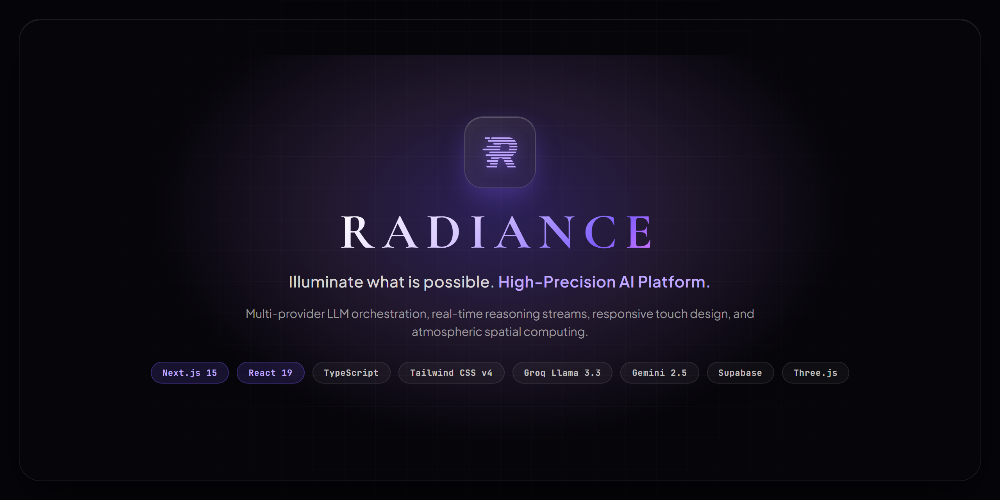
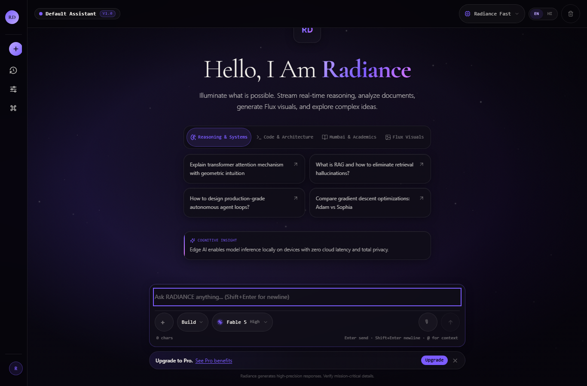
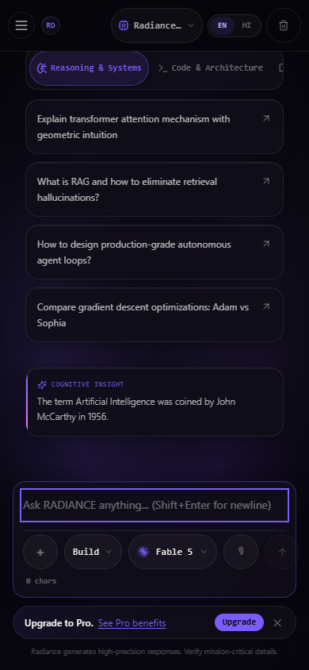
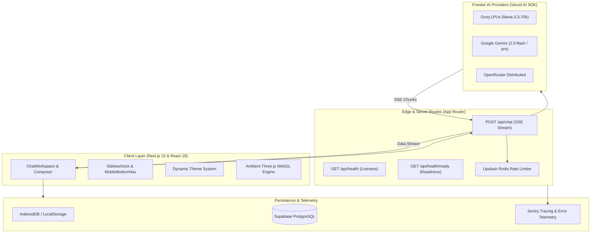

<div align="center">

  

  # RADIANCE
  
  **Illuminate what is possible.**

  An editorial, high-performance AI workspace and intelligence canvas engineered for multi-model reasoning, ambient design, and deep productivity.

  <br />

  [](https://github.com/TanishBane/Tanixai/actions/workflows/ci.yml)
  [](https://github.com/TanishBane/Tanixai/actions/workflows/codeql.yml)
  [](https://github.com/TanishBane/Tanixai/actions/workflows/docs.yml)
  [](LICENSE)
  [](https://nextjs.org/)
  [](https://react.dev/)
  [](https://www.typescriptlang.org/)
  [](https://tailwindcss.com/)

  <br />
  <br />

  

</div>

---

## Highlights

- **Multi-Model Intelligence Routing:** Dynamically route queries across Groq LPUs (`llama-3.3-70b-versatile`), Google Gemini (`gemini-2.5-flash`, `gemini-2.5-pro`), and OpenRouter open-weights models with automatic capability-based multimodal switching.
- **Real-Time Streaming & Partial Token Retention:** Ultra-fast Server-Sent Events (SSE) streaming powered by the Vercel AI SDK (`4.1.54`). Stopping generation safely retains all streamed tokens in conversational state and persistence without data loss.
- **Atmospheric Visual Identity:** Dark violet aesthetic (`#06050a`), restrained neon accents, fluid typography combining Plus Jakarta Sans and Cormorant Garamond, and a WebGL Three.js ambient background with adaptive mobile level-of-detail (LOD).
- **Touch-First Mobile Ergonomics:** Specially engineered thumb-zone navigation (`MobileBottomNav`), bottom-sheet drawers, swipe-friendly prompt categories, and 100dvh virtual keyboard compensation.
- **Editorial Markdown & KaTeX Mathematics:** Complete GitHub Flavored Markdown support, KaTeX LaTeX typesetting for mathematical formulas, syntax-highlighted code fences with one-click copy, and full session export to Markdown and JSON.
- **Enterprise Observability & Health Gates:** Real-time health probes (`/api/health` and `/api/health/ready`), distributed OpenTelemetry tracing, Sentry error monitoring, Upstash Redis rate limiting, and automated bundle size budget gates.

---

## Interface Preview

<div align="center">
  <table>
    <tr>
      <td width="65%" align="center" valign="top">
        <strong>Desktop AI Canvas</strong><br /><br />
        
      </td>
      <td width="35%" align="center" valign="top">
        <strong>Mobile Touch Experience</strong><br /><br />
        
      </td>
    </tr>
  </table>
</div>

---

## System Architecture

Radiance follows a clean layered architecture separating presentation, streaming orchestration, persistence, and external inference engines:



---

## Technology Stack

| Domain | Technologies & Libraries |
|:---|:---|
| **Frontend Framework** | [Next.js 15.2.1](https://nextjs.org/) (App Router), [React 19.0.0](https://react.dev/), [TypeScript 5.8.2](https://www.typescriptlang.org/) |
| **Styling & Design** | [Tailwind CSS v4](https://tailwindcss.com/), CSS Custom Properties, Lucide Icons |
| **Motion & 3D** | [Motion for React](https://motion.dev/) (12.4.10), [Three.js](https://threejs.org/) (0.174.0) WebGL shaders |
| **AI Inference** | [Vercel AI SDK](https://sdk.vercel.ai/) (`ai` 4.1.54, `@ai-sdk/groq`, `@ai-sdk/google`, `@ai-sdk/openai`) |
| **Typography & Math** | [KaTeX](https://katex.org/), Plus Jakarta Sans, Cormorant Garamond, JetBrains Mono |
| **Persistence & Auth** | [Supabase](https://supabase.com/) (`@supabase/supabase-js`, `@supabase/ssr`), Local Storage / IndexedDB |
| **Observability** | [Sentry](https://sentry.io/) (`@sentry/nextjs`), OpenTelemetry, [Upstash Redis](https://upstash.com/) |
| **Testing & Quality** | [Vitest](https://vitest.dev/), [Playwright](https://playwright.dev/), Lighthouse CI, TypeScript |

---

## Quick Start

### 1. Prerequisites
- **Node.js:** `v20.x` or `v22.x`
- **pnpm:** `v9.x` or `v10.x`

### 2. Clone and Install
```bash
# Clone the repository
git clone https://github.com/TanishBane/Tanixai.git
cd Tanixai

# Install dependencies using frozen lockfile
pnpm install
```

### 3. Configure Environment
```bash
cp .env.example .env.local
```
Configure your AI provider keys in `.env.local`:
```bash
# At least one provider API key is required:
GROQ_API_KEY="your-groq-api-key"
GEMINI_API_KEY="your-gemini-api-key"
```
Refer to the [Environment Setup Guide](docs/getting-started/environment.md) for full parameter definitions.

### 4. Start the Application
```bash
pnpm dev
```
Navigate to [http://localhost:3000](http://localhost:3000) to enter the Radiance workspace.

---

## Verification & Quality Commands

Radiance enforces an evidence-before-claims discipline (`verification-before-completion`). Run the official test commands:

```bash
# Typecheck TypeScript codebase
pnpm typecheck

# Execute ESLint static analysis
pnpm lint

# Run Vitest unit & adversarial stress test suites (445+ tests)
pnpm test

# Run Playwright cross-browser End-to-End matrix
pnpm test:e2e

# Validate production bundle size budgets (< 800kB /page, < 220kB /layout)
pnpm build
pnpm measure:bundle

# Audit documentation links and asset integrity
pnpm docs:check
```

---

## Documentation Hub

Explore the in-depth documentation tree:

- **Getting Started:**
  - [Installation Guide](docs/getting-started/installation.md)
  - [Environment Variables](docs/getting-started/environment.md)
- **Architecture:**
  - [System Overview & Layer Boundaries](docs/architecture/overview.md)
  - [AI Orchestration & Streaming Pipeline](docs/architecture/ai-orchestration.md)
- **Features:**
  - [Conversation Engine & Chat Lifecycle](docs/features/conversations.md)
  - [Multi-Model Registry & Capability Matrix](docs/features/model-selection.md)
- **Development:**
  - [Local Development Guide](docs/development/local-development.md)
  - [Testing & Verification Strategy](docs/development/testing.md)
- **Operations & Runbooks:**
  - [Operational Overview](docs/operations/OVERVIEW.md)
  - [Sentry Monitoring](docs/operations/SENTRY.md)
  - [CI/CD Automation](docs/operations/CI_CD.md)
  - [Incident Response](docs/operations/INCIDENT_RESPONSE.md)
  - [Troubleshooting Runbook](docs/operations/TROUBLESHOOTING.md)

---

## Project Structure

```
Tanixai/
├── .github/
│   ├── workflows/             # CI, CodeQL, Dependency Review, Gitleaks, Docs
│   └── ISSUE_TEMPLATE/        # Standardized issue reporting forms
├── docs/                      # Architectural, development, and operational guides
│   ├── architecture/          # Topology and AI streaming pipeline
│   ├── assets/                # OpenGraph assets, brand logos, screenshots
│   ├── development/           # Tooling, scripts, and testing specs
│   ├── features/              # Conversation lifecycle and model registry
│   ├── getting-started/       # Onboarding and environment configuration
│   └── operations/            # Sentry, incident response, troubleshooting
├── public/                    # Favicons, Web App Manifest, brand vectors
├── scripts/                   # Bundle measurement, docs auditing, social cards
├── src/
│   ├── app/                   # Next.js App Router routes and layouts
│   ├── components/            # UI components (chat, navigation, modals, background)
│   ├── features/              # Feature domain hooks and sub-components
│   └── lib/                   # AI providers, Supabase, types, observability, motion
└── tests/
    ├── e2e/                   # Playwright end-to-end browser specifications
    └── unit/                  # Vitest unit and adversarial stress test suites
```

---

## Roadmap

- [x] **v1.0.0 — Production Core**
  - Next.js 15 + React 19 App Router architecture
  - Multi-provider inference (Groq, Gemini, OpenRouter)
  - Full mobile-first touch optimization & 100dvh composer
  - KaTeX math typesetting & syntax-highlighted code fences
  - Health check endpoints (`/api/health`, `/api/health/ready`)
  - Enterprise Sentry observability & Upstash rate limiting
- [ ] **v1.1.0 — Retrieval-Augmented Generation (Planned)**
  - Local document ingestion & pgvector vector embeddings
  - Semantic similarity search over conversation history
  - Multi-user collaborative workspaces with role-based access

---

## Contributing & Community

We welcome contributions! Please review our community health guidelines before opening a pull request:

- [Contributing Guidelines](CONTRIBUTING.md)
- [Code of Conduct](CODE_OF_CONDUCT.md)
- [Security Policy](SECURITY.md)
- [Support Guidelines](SUPPORT.md)
- [Changelog](CHANGELOG.md)

---

## License

Radiance is open-source software licensed under the [MIT License](LICENSE).
