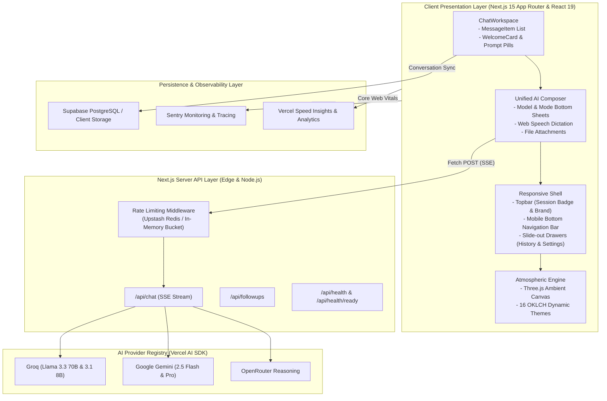

# System Architecture Overview

**RADIANCE** is architected as a modular, high-craft AI workspace built on modern web standards, edge-ready API routes, and multi-provider model orchestration.

---

## 1. High-Level Architecture Topology

---

## 2. Layer Separation & Boundaries

1. **Presentation Layer (`src/components/`, `src/features/`):**
   - React 19 client components with strict prop contracts.
   - Pinned 100dvh viewport layout with touch-first ergonomics.
   - Zero hardcoded color palettes; all surfaces consume semantic CSS custom properties (`var(--accent)`, `var(--surface)`, `var(--void)`).
2. **Formatting & Parsing Engine (`src/lib/utils/`):**
   - Stream-safe Markdown parsing with code fence auto-closing in `format.ts`.
   - KaTeX LaTeX equation rendering (`math-renderer.ts`).
   - Tokenized code highlighting with line numbering (`syntax-highlighter.ts`).
   - Strict XSS escaping and URI scheme validation (`isSafeUrl`).
3. **State & Streaming Layer (`src/features/chat/hooks/`):**
   - `useChatStream`: Persistent cross-chunk line buffer to prevent token drops over SSE.
   - `useChatSession`: Multi-conversation lifecycle, message editing, branching, and persistence.
4. **AI Model Layer (`src/lib/ai/`):**
   - Unified multi-provider abstraction (`models.ts`, `providers.ts`).
   - Circuit breaker and error handling for remote provider timeouts.
5. **Data & Persistence (`src/lib/db/`):**
   - Supabase SSR integration with seamless fallback to browser localStorage when offline or unconfigured.
