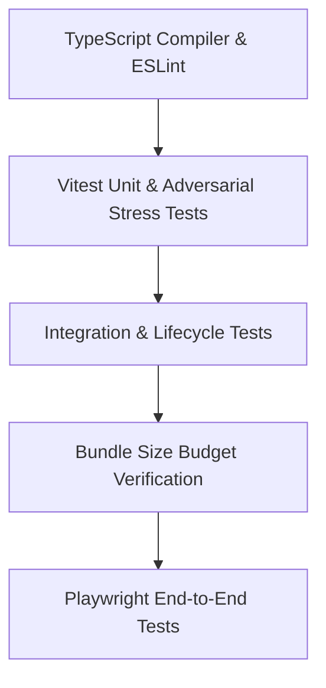

# Testing & Verification Strategy

This document specifies the verification architecture, test pyramid, coverage scopes, and automated quality gates enforced across Radiance.

---

## 1. Verification Architecture & Pyramid

Radiance enforces an evidence-based testing discipline (`verification-before-completion`). Code is never considered finished until verified against automated unit, stress, E2E, and bundle budget tests.



---

## 2. Unit & Adversarial Stress Suites (Vitest)

Radiance maintains 31 test files containing over 445 unit and stress tests executed via Vitest and jsdom.

### 2.1 Key Test Suites
- **Adversarial Markdown Parsing (`format-security-adversarial.test.ts`):** Validates that malformed markdown, unclosed code fences, deeply nested blockquotes, and HTML injection attempts cannot cause catastrophic backtracking or DOM corruption.
- **Concurrency & Collision Stress (`challenger-m2-concurrency.test.tsx`):** Verifies 10,000 rapid conversation ID generations with zero collisions and verifies session isolation under simultaneous streaming events.
- **Stop Button Partial Token Retention (`challenger-m3-stop-token-retention.test.tsx`):** Confirms that terminating active generation retains all previously streamed tokens in state and storage without data loss.
- **Workspace Lifecycle & Contamination (`challenger-m3-workspace-lifecycle.test.tsx`):** Rigorously verifies that creating a new chat or deleting sessions cleanly aborts active inference streams without leaking ghost tokens into the newly selected session.
- **Mobile Navigation & Accessibility (`navigation-drawers.test.tsx`, `mobile-cross-browser.test.tsx`):** Confirms dialog ARIA landmarks, modal traps, keyboard dismissal, and mobile viewport adaptations.

### 2.2 Execution
```bash
# Run all unit tests
pnpm test

# Run a specific test suite
pnpm test tests/unit/chat-composer.test.tsx

# Run with watch mode
pnpm vitest
```

---

## 3. End-to-End Testing (Playwright)

End-to-End tests execute against real browser engines configured across both desktop and mobile viewports.

### 3.1 Browser Matrix
- **Desktop Chrome:** 1440x900 viewport
- **Desktop Firefox:** 1440x900 viewport
- **Desktop WebKit (Safari):** 1440x900 viewport
- **Mobile Chrome (Pixel 5):** 393x851 viewport, touch enabled, DPR 2.75
- **Mobile Safari (iPhone 12):** 390x844 viewport, touch enabled, DPR 3.0

### 3.2 Execution
```bash
# Run all E2E tests (headless)
pnpm test:e2e

# Run with list reporter (recommended for CI / background tasks)
npx playwright test --reporter=list

# Run only mobile browser projects
npx playwright test --project="Mobile Chrome" --project="Mobile Safari"
```

---

## 4. Performance & Bundle Size Budgets

To prevent bundle bloat and ensure fast Time to Interactive (TTI), bundle size thresholds are enforced on every production build via `scripts/measure-bundle.mjs`:

| Route / Entry | Metric | Budget (gzip) | Target |
|:---|:---|:---:|:---:|
| `/page` (Chat Workspace) | Gzipped Size | **< 800 kB** | ~712 kB |
| `/layout` (App Shell) | Gzipped Size | **< 220 kB** | ~182 kB |

Run bundle verification:
```bash
pnpm build
pnpm measure:bundle
```

---

## 5. Documentation & Markdown Link Auditing

All markdown documentation, relative links, image assets, and environment variables are automatically validated via the documentation audit suite:

```bash
pnpm docs:check
```
