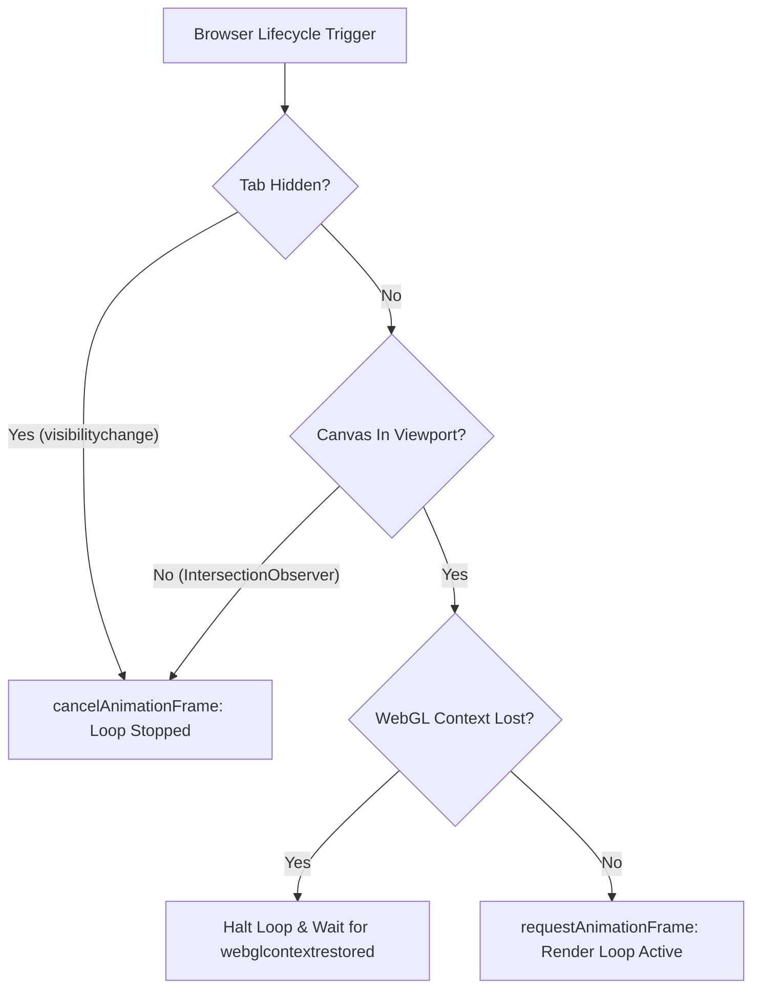

# Radiance Motion Architecture & Systems Specification

**Status:** Canonical Engineering Specification  
**Scope:** Complete Radiance application and landing motion architecture  
**Governing Standards:** 60fps/120fps GPU Compositor Execution, Zero Layout Thrashing, WCAG 2.2 AA Motion Compliance  

---

## 1. Architectural Philosophy & Guiding Invariants

Radiance balances high-craft, cinematic visual expression with uncompromising runtime performance. Animation in Radiance is never purely decorative; it serves three precise product functions:
1. **Spatial Continuity & Wayfinding:** Clarifying state transitions, modal drawers, and content replacements so users never lose spatial context.
2. **Immediate Interaction Feedback:** Responding to clicks, taps, keystrokes, and selections in under 16ms with calibrated physical spring dynamics.
3. **Product Truth & Narrative Pacing:** Guiding the user's attention through Personal Intelligence workflows and bounded context architecture without visual exhaustion.

### Core Engineering Invariants

```
┌────────────────────────────────────────────────────────────────────────┐
│                   RADIANCE ZERO-JANK MOTION INVARIANTS                 │
├────────────────────────────────┬───────────────────────────────────────┤
│ 1. Compositor-Only Mutation    │ Animations strictly mutate transform  │
│                                │ and opacity. No animating layout.     │
├────────────────────────────────┼───────────────────────────────────────┤
│ 2. Sub-24px Spatial Travel     │ Spatial offsets capped at 8px-24px to │
│                                │ prevent disruptive visual jumps.      │
├────────────────────────────────┼───────────────────────────────────────┤
│ 3. Universal Reduced-Motion    │ Every motion element provides a zero- │
│                                │ duration, non-translating fallback.   │
├────────────────────────────────┼───────────────────────────────────────┤
│ 4. Isolated Component Timing   │ Recurring timers (e.g. clocks) must   │
│                                │ never re-render parent visual trees.  │
├────────────────────────────────┼───────────────────────────────────────┤
│ 5. Adaptive Hardware Clamping  │ DPR max 1.5 on mobile; render loops   │
│                                │ halt when tab hidden or offscreen.    │
└────────────────────────────────┴───────────────────────────────────────┘
```

---

## 2. Motion Design Tokens & Calibration (`src/lib/motion/presets.ts`)

Radiance centralizes all animation durations, cubic-bezier curves, physical springs, and spatial travel distances into a single type-safe token module:

```typescript
export const motionDurations = {
  feedback: 0.15,    // Tactile button/chip response (150ms)
  interaction: 0.20, // Tab switches, preference toggles (200ms)
  entrance: 0.28,    // In-view component reveals (280ms)
  drawer: 0.24,      // Sheet/dialog slide transitions (240ms)
  section: 0.48,     // Full section hero/story transitions (480ms)
  story: 0.60,       // Complex multi-element narrative reveals (600ms)
} as const;

export const motionEasing = {
  standard: [0.2, 0.8, 0.2, 1] as [number, number, number, number],
  entrance: [0.16, 1, 0.3, 1] as [number, number, number, number],
} as const;

export const motionDistances = {
  subtle: 8,       // Content presence swaps, tooltips, chips
  component: 16,    // Card reveals, dock items
  section: 24,      // Major landing section headers and panels
} as const;

export const motionSprings = {
  feedback: { type: "spring", stiffness: 420, damping: 32, mass: 0.7 },
  panel: { type: "spring", stiffness: 320, damping: 30, mass: 0.85 },
} as const;
```

### Motion Easing Justification
- **`motionEasing.entrance` (`cubic-bezier(0.16, 1, 0.3, 1)`):** A decelerated curve that initiates quickly and eases gently to a rest, creating a sense of physical arrival without rubber-banding or overshoot.
- **`motionEasing.standard` (`cubic-bezier(0.2, 0.8, 0.2, 1)`):** Symmetrical smooth easing used for continuous transitions and dialog open/close states.

---

## 3. Universal Reveal Helper (`getRevealMotion`)

To eliminate hand-authored divergent animations across landing pages and prevent Content Layout Shift (CLS) before hydration, Radiance uses `getRevealMotion`:

```typescript
export function getRevealMotion(
  prefersReducedMotion = false,
  distance: keyof typeof motionDistances = "section"
) {
  if (prefersReducedMotion) {
    return {
      initial: false,
      animate: { opacity: 1, y: 0 },
      transition: { duration: 0 },
    } as const;
  }

  return {
    initial: { opacity: 0, y: motionDistances[distance] },
    animate: { opacity: 1, y: 0 },
    transition: getMotionTransition(distance === "section" ? "section" : "entrance"),
  } as const;
}
```

### Key Engineering Properties:
1. **Zero-Flash Reduced Motion:** When `prefersReducedMotion` is true, `initial` is explicitly set to `false`, preventing elements from mounting invisibly at `opacity: 0`.
2. **Predictable Staggering:** Child elements in grids (`ContextPipelineSection`, `PersonalIntelligenceStory`, `PrivacyFortress`) apply bounded progressive delays (`idx * 0.1s` or `idx * 0.12s`) to establish a clear visual scanpath without extending total entrance time beyond 0.8s.

---

## 4. Clock Isolation Architecture (`HeroLiveClock`)

### The Performance Anti-Pattern Identified
In the original landing hero implementation, a live 1-second telemetry clock was maintained directly in the top-level `HeroLandscape` component state:

```tsx
// ❌ ANTI-PATTERN: Re-renders the entire hero tree every 1,000ms
export function HeroLandscape() {
  const [currentTime, setCurrentTime] = useState("07:23:14 AM");
  useEffect(() => {
    const interval = setInterval(updateTime, 1000);
    return () => clearInterval(interval);
  }, []);
  // ...renders showcase grid, SVG torus, product stage, intelligence field...
}
```

This caused:
- 60 unnecessary React component reconciliations every minute.
- Continuous garbage collection pressure and main thread wakeups.
- Micro-stutter during concurrent user interactions (e.g. selecting mock suggestions in `HeroProductStage`).

### The Isolated Architecture Implemented
The clock was decoupled into an isolated `HeroLiveClock` component wrapped in `React.memo`:

```tsx
// ✅ PRODUCTION SOLUTION: Confines state re-renders strictly to clock element
const HeroLiveClock = memo(function HeroLiveClock() {
  const [currentTime, setCurrentTime] = useState("07:23:14 AM");
  useEffect(() => {
    const updateTime = () => setCurrentTime(new Date().toLocaleTimeString("en-US", ...));
    updateTime();
    const interval = setInterval(updateTime, 1000);
    return () => clearInterval(interval);
  }, []);
  return <span className="telemetry-clock-value" aria-label="Live timestamp">{currentTime}</span>;
});
```

**Outcome:** `HeroLandscape`, its fluted glass torus, and product demonstrations now render exactly once on mount, achieving zero main-thread overhead while preserving live telemetry.

---

## 5. WebGL & Canvas Lifecycle Orchestration

Continuous animation loops represent the largest potential source of GPU thermal load and battery consumption. Radiance implements triple-gated lifecycle controls:



### 1. Tab Invisibility Interception
When users switch tabs or minimize the browser, `document.addEventListener("visibilitychange")` immediately cancels the active `requestAnimationFrame` handle. Zero GPU or CPU cycles are consumed in the background.

### 2. Offscreen Viewport Interception
An `IntersectionObserver` with `threshold: 0.01` tracks whether the background canvas is within the visible document rect. When scrolled out of sight, rendering halts immediately.

### 3. Pointer & Mouse Event Decoupling
Mouse tracking in `webgl-starfield.tsx` and `ambient-canvas.tsx` never recalculates 3D coordinates synchronously inside `pointermove` listeners. Instead, events store normalized target coordinates into lightweight scalar refs (`targetMouseX`, `targetMouseY`), which are smoothly interpolated during the active RAF frame using exponential decay (`lerp`):

```typescript
currentMouseX += (targetMouseX - currentMouseX) * 0.04;
currentMouseY += (targetMouseY - currentMouseY) * 0.04;
```

This decouples high-frequency mouse reports (1,000Hz gaming mice) from the display refresh rate (60Hz–120Hz), eliminating event listener congestion.

---

## 6. GPU Compositing & CSS Containment

To ensure the browser's compositing thread can process animations independently of the layout engine:
1. **Composite Layer Promotion:** Heavy CSS animations (such as `.aurora-torus-svg`) declare `will-change: transform` and `transform: translateZ(0)`.
2. **Strict Layout Isolation:** Section containers declare `contain: paint` or `content-visibility: auto` with `contain-intrinsic-size` hints, allowing the browser to skip layout and painting of offscreen sections until approaching viewport boundaries.
3. **No Filter Animation:** Static backdrop blurs (`backdrop-filter: blur(14px)`) are applied to stationary reeded glass slats, while animated light rings avoid animating blur radiuses dynamically.
